# Random Truncation of Text Embeddings: a Live Demo and Reproduction

CS F429 (Introduction to NLP), BITS Pilani Hyderabad, Group 12, paper 14.

> Sotaro Takeshita, Yurina Takeshita, Daniel Ruffinelli and Simone Paolo Ponzetto. *Randomly Removing 50% of Dimensions in Text Embeddings has Minimal Impact on Retrieval and Classification Tasks.* EMNLP 2025 ([arXiv 2508.17744](https://arxiv.org/abs/2508.17744), PDF in `docs/paper.pdf`).

This repository re-tests the paper's central claim **live, on your own laptop CPU, in about a minute**, and contains the full reproduction behind it.

| | |
|---|---|
| **The claim** | Deleting a random half of the numbers in a text embedding keeps more than 90% of retrieval quality and more than 95% of classification accuracy. |
| **What the demo does** | Encodes real data with a real encoder, deletes dimensions, measures the quality and prints it next to the paper's numbers, followed by a one-line verdict. |
| **Time and hardware** | About 1 minute, CPU only, no GPU, no large download (a 70 MB zip). |

## Quick start in four lines

1. Download `embedding-truncation-lite.zip` from the [`lite-v1` release](https://github.com/cfcmadlad/embedding-truncation-repro/releases/tag/lite-v1) and unzip it.
2. Open a terminal in the unzipped folder `embedding-truncation-lite`.
3. Run `.
un.bat` on Windows or `./run.sh` on macOS and Linux. The very first call installs the packages (5 to 8 minutes, internet needed once); every later call takes about a minute and works offline.
4. Read the last lines: they end with `VERDICT  the paper's claim holds in this live run.`

Everything is explained step by step in [Part 1](#part-1-run-the-demo); the presenter's 90-second script is in [docs/RUN_SHEET.md](docs/RUN_SHEET.md).

## Contents

- [Part 1. Run the demo](#part-1-run-the-demo): what you will see, requirements, step-by-step commands, fixing problems, where it was tested, the optional Streamlit demo
- [Part 2. The paper explained in detail](#part-2-the-paper-explained-in-detail)
- [Part 3. Our reproduction](#part-3-our-reproduction): results, scope, method, layout, reproducing everything

---

# Part 1. Run the demo

## 1.1 What you will see

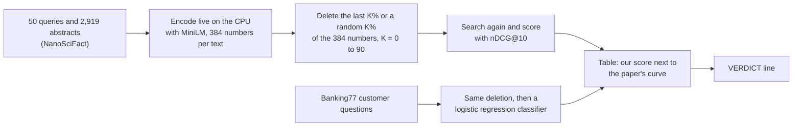

Everything is computed on your machine. The encoder is a small model whose weights ship inside the zip (`lite/models/minilm`), so no internet is needed after the one-time installation.

## 1.2 Requirements

| Item | Needed |
|---|---|
| Operating system | Windows 10 or 11, macOS, or Linux |
| Python | 3.10, 3.11, 3.12 or 3.13. Check with `python --version` (on Windows also try `py --version`). If it is missing, install Python 3.12 from [python.org](https://www.python.org/downloads/) and tick **Add python.exe to PATH** on Windows |
| Disk | about 2 GB free (the private Python environment is about 1.5 GB, the kit 0.1 GB) |
| Internet | once, for installing the packages (5 to 8 minutes). Do this at home, not in the exam room |
| GPU | not used |

## 1.3 Step by step

**Step 1. Download the kit.** Open the [`lite-v1` release](https://github.com/cfcmadlad/embedding-truncation-repro/releases/tag/lite-v1) and download `embedding-truncation-lite.zip` (70 MB). A USB stick copy works the same way.

**Step 2. Unzip it.** Windows: right click the zip, choose *Extract All*. macOS: double click. Linux: `unzip embedding-truncation-lite.zip`. You get a folder `embedding-truncation-lite`. Folder names with spaces are fine.

**Step 3. Open a terminal inside that folder.**
- Windows: open the folder in File Explorer, click the address bar, type `cmd`, press Enter.
- macOS: right click the folder, *New Terminal at Folder* (or open Terminal and `cd` into it).
- Linux: open a terminal and `cd embedding-truncation-lite`.

**Step 4. Run the launcher.**

Windows (Command Prompt or PowerShell):

```bash
.\run.bat
```

macOS or Linux (the first time only, make the script executable):

```bash
chmod +x run.sh
```

```bash
./run.sh
```

What happens: the first call creates a private environment `.venv` in the folder and installs the packages from `requirements-demo.txt`. It prints `Installing dependencies once...` and then stays quiet for 5 to 8 minutes. Later calls skip this and start immediately. Nothing is installed outside the folder.

On Windows you can also **double-click `run.bat`** in File Explorer: the window stays open at the end ("Press any key") so the output can be read. On a PC with fewer than 4 CPU cores the launcher switches to the fast mode by itself and says so; add `--full` to force the full run.

**Step 5. Read the output.** After the installation the live run starts and takes about a minute (up to 90 s on a busy or slower machine). Annotated:

```
model      sentence-transformers/paraphrase-MiniLM-L3-v2 (384 dimensions, cos similarity)   <- the encoder
startup    imports and encoder load 12.8 s
dataset    NanoSciFact: 50 queries, 2919 of 2919 documents                                   <- the data
encoded    2969 texts live in 25.4 s (117 texts per second, cpu, 8 threads)                  <- live encoding
full       nDCG@10 0.4713                                                                    <- score with all 384 numbers

 removed    last-K   random-K     std  kept (%)  paper avg (%)
      0%    0.4713     0.4713  0.0000     100.0          100.0
     50%    0.4481     0.4438  0.0168      94.2           95.5     <- delete half: 94.2% of the quality is kept
     90%    0.2637     0.2294  0.0525      48.7           62.0

remove vs zero   ... nDCG@10 0.4447 and 0.4447, largest score difference 4.2e-07   <- deleting equals zeroing
... Banking77 classification table: 50% removed keeps 97.7% of the accuracy ...

retrieval       random 50% keeps 94.2% of nDCG@10 (paper bar: over 90%, paper Para-MiniLM: 94.6%)
classification  random 50% keeps 97.7% of accuracy (paper bar: over 95%, paper Para-MiniLM: 97.4%)
VERDICT  the paper's claim holds in this live run.
```

How to read the table:

| Column | Meaning |
|---|---|
| `removed` | percentage of the 384 dimensions deleted |
| `last-K` | nDCG@10 after deleting the last K% of the dimensions |
| `random-K` | nDCG@10 after deleting a random K%, averaged over 10 random draws (seeds 0 to 9) |
| `std` | standard deviation of `random-K` over the 10 draws |
| `kept (%)` | `random-K` as a percentage of the full score (100 means nothing was lost) |
| `paper avg (%)` | the paper's own curve (its Figure 1, average of 6 encoders on BEIR), for comparison |

The last digit can differ by a few thousandths on another CPU. The verdict does not change.

**Step 6 (optional). Other modes.** Every mode is `run.bat <mode>` on Windows and `./run.sh <mode>` on macOS or Linux:

| Command | What it does | Time |
|---|---|---|
| `.\run.bat` | the full live run described above | about 1 minute |
| `.\run.bat fast` | cuts the corpus to 400 documents (all judged ones kept); add `--threads 1` for a slow CPU | 35 to 65 s |
| `.\run.bat replay` | prints the stored result of an earlier run, labelled as stored | 1 s |
| `.\run.bat check` | prints `ok` or `FAIL` for Python, packages, model, data and a smoke run | 20 s |
| `.\run.bat selfcheck` | runs all of the above and writes `selfcheck_report_<host>.txt` to send back | 3 minutes |
| `.\run.bat test` | runs the automated tests (25; 2 are skipped without the full cache and pytrec_eval) | 10 s |

Examples: `.\run.bat fast --threads 1`, `.\run.bat check`.

## 1.4 If something goes wrong

If the live run cannot encode for any reason, it prints the error and then the stored result of an earlier live run, labelled `STORED RESULT, NOT RECOMPUTED`. Say that it is stored; never present it as live.

| Problem | What to do |
|---|---|
| `'run.bat' is not recognized` in PowerShell | Type `.\run.bat` with the dot and backslash |
| `FAIL: no Python 3.10 to 3.13 found` | Install Python 3.12 from python.org, tick **Add python.exe to PATH**, open a new terminal |
| pip fails with `CERTIFICATE_VERIFY_FAILED` | Antivirus HTTPS scanning. The launcher retries once by itself with certificate checks relaxed for `pypi.org` and `files.pythonhosted.org` only |
| `permission denied` on macOS or Linux | `chmod +x run.sh` |
| Windows SmartScreen warns about `run.bat` | *More info*, then *Run anyway*; or run `.venv\Scripts\python scripts\live_small.py` |
| The output says `STORED RESULT, NOT RECOMPUTED` | Encoding failed. Run `.\run.bat check`, read the `FAIL` line, then `python scripts/fetch_lite.py` (needs internet) |
| The run takes more than 2 minutes | Close other programs, use `.\run.bat fast --threads 1` |
| First call looks frozen | It is installing (5 to 8 minutes); wait for the prompt |
| No internet in the room | Not a problem: after the installation the live run never uses the network |

Before the demo day, run `.\run.bat selfcheck` once on your own laptop and send the report file to the group ([docs/SELF_CHECK.md](docs/SELF_CHECK.md)). The presenter's script with what to say at each step is [docs/RUN_SHEET.md](docs/RUN_SHEET.md).

**Install from git instead of the zip.** The model weights are not stored in git. After cloning, fetch them once, then use the launcher as above:

```bash
git clone https://github.com/cfcmadlad/embedding-truncation-repro.git
```

```bash
cd embedding-truncation-repro
```

```bash
python scripts/fetch_lite.py
```

## 1.5 Where this has been tested

| Environment | Result |
|---|---|
| Windows 11, Python 3.13, fresh environment, kit unzipped into a folder with spaces in its name | install, `check` all ok, live run 48 to 60 s |
| Windows 11, Python 3.12.4, installed through `run.bat` behind antivirus HTTPS scanning | install succeeded after the automatic retry, live run 48 s |
| Windows 11, Python 3.10.21 | `check` ok, 24 tests pass, live run 45 s, `fast --threads 1` 34 s |
| Same kit, no internet (dead proxy), empty Hugging Face cache | live run 60 s, correct verdict, nothing downloaded |
| Encoder files hidden (simulated broken install), 5 times | error line, then the stored table labelled `STORED RESULT, NOT RECOMPUTED`, 15 to 22 s |
| 5 full rehearsals, GPU hidden with `CUDA_VISIBLE_DEVICES=-1` | identical numbers every time, 48 to 55 s |

All of these ran on one Windows laptop (8 physical cores). macOS, Linux, Python 3.11 and machines with fewer cores are expected to work (the launcher, the version ranges and the automatic fast mode are written for them) but have not been run by us; the `selfcheck` mode exists so that any machine can prove it in 3 minutes ([docs/SELF_CHECK.md](docs/SELF_CHECK.md)).

## 1.6 Optional: the interactive Streamlit demo

The Streamlit app lets you pick any of 6 models, 17 datasets and 5 truncation methods with a slider. It needs the **full embedding cache** (1.7 GB download, 2.7 GB unpacked) and Python 3.12 or newer. It is not needed for the live run.

```bash
git clone https://github.com/cfcmadlad/embedding-truncation-repro.git
```

```bash
cd embedding-truncation-repro
```

```bash
python -m venv .venv
```

Activate the environment (Windows, then macOS or Linux):

```bash
.venv\Scripts\activate
```

```bash
source .venv/bin/activate
```

Install the packages (CPU build of PyTorch first), download the cache, and check:

```bash
pip install torch==2.9.0 --index-url https://download.pytorch.org/whl/cpu
```

```bash
pip install -r requirements.txt
```

```bash
python scripts/fetch_cache.py
```

```bash
python scripts/demo_cli.py --model mpnet --dataset NanoSciFact --k 50 --method random --seed 0
```

The last command must print full nDCG@10 0.6967, truncated nDCG@10 0.6908, relative 99.15%. Then start the app (it opens in the browser; first load about 10 s, clicks under 1.5 s):

```bash
streamlit run demo/app.py
```

If port 8501 is busy Streamlit picks 8502 and prints the address. In the sidebar choose the model, dataset, method (last-K, random-K with a seed, PCA, remove degrading, remove improving) and K. The main panel shows the full and truncated score, the relative score, the rank correlation and the curve with the paper's value. The query panel shows the top 5 documents before and after truncation. The second tab shows our three extension experiments. Typing a new query encodes it live and needs that encoder on disk (`python scripts/fetch_lite.py --models mpnet`). Classification with PCA or the degrading and improving methods refits 10 logistic regressions (about 5 s the first time).

`demo_cli.py` prints the same numbers without a browser (`--model` minilm, mpnet, contriever, e5, mrl, nonmrl; `--dataset` any NanoBEIR dataset or Banking77, Emotion, TweetSentimentExtraction, MTOPIntent; `--method` last, random, pca, degrading, improving; `--k` 0 to 90; `--seed` 0 to 9).

---

# Part 2. The paper explained in detail

## 2.1 The paper in one minute

Modern text encoders turn a sentence into a vector of hundreds or thousands of numbers (an *embedding*). Search engines, RAG systems and classifiers all work on these vectors, and storing them is expensive. The paper asks: what happens if we simply throw away some of the numbers? Its surprising answer is that throwing away **a random half** costs very little, for six different encoders and 26 tasks. It then asks *why*, rules out three popular explanations, and proposes its own: the vector contains many "degrading" dimensions that actually hurt performance, so a random cut removes helpful and harmful dimensions in roughly equal numbers.

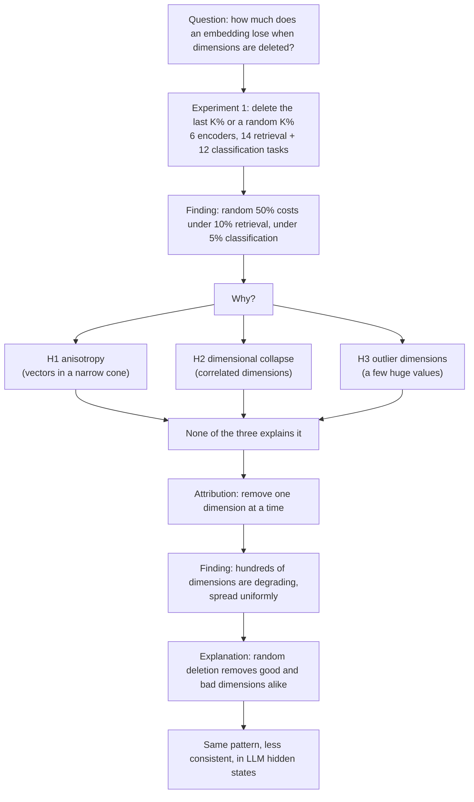

## 2.2 Background you need

**Embedding and similarity.** An encoder maps a text to a vector in R^n (n = 384 for MiniLM, 768 for MPNet, Contriever and Sentence-T5, 1024 for E5-large, 4096 for E5-Mistral). The similarity of a query q and a document d is either the dot product, or the cosine, which divides by the lengths:

```
dot(q, d)    = q_1 d_1 + q_2 d_2 + ... + q_n d_n
cos(q, d)    = dot(q, d) / ( |q| |d| )
```

Contriever uses the raw dot product; the other models use cosine.

**Retrieval and nDCG@10.** Given a query, the system ranks all documents by similarity. The metric nDCG@10 looks only at the top 10 and rewards putting relevant documents high:

```
DCG@10  = sum over ranks r = 1..10 of  gain(r) / log2(r + 1)
nDCG@10 = DCG@10 / (DCG@10 of the perfect ranking)          (between 0 and 1)
```

The paper uses 14 BEIR datasets (13 NanoBEIR subsets with 50 queries each for E5-Mistral and for the attribution analysis).

**Classification.** A logistic regression is trained on the embeddings of a few labelled examples and scored by accuracy on the test set, following the MTEB benchmark (12 tasks in the paper: AmazonCounterfactual, AmazonPolarity, AmazonReviews, Banking77, Emotion, Imdb, MassiveIntent, MassiveScenario, MTOPDomain, MTOPIntent, ToxicConversations, TweetSentimentExtraction).

**Relative performance.** Every curve in the paper divides the score of the truncated embedding by the score of the full embedding:

```
relative performance (%) = 100 * score(truncated) / score(full)
```

**Spearman correlation.** Compares two rankings of the same documents (full against truncated embedding). 1 means identical order, 0 means unrelated.

## 2.3 The six encoders

| Encoder | Size | Dimensions | Similarity | What it is |
|---|---|---|---|---|
| MPNet base | 109M | 768 | cosine | general sentence encoder |
| Contriever | 110M | 768 | dot product | unsupervised contrastive retriever, **not normalised** |
| E5-large | 335M | 1024 | cosine | retrieval encoder trained with `query:` and `passage:` prefixes |
| E5-Mistral | 7B | 4096 | cosine | LLM-based encoder (the only large one) |
| Paraphrase-MiniLM | 17M | 384 | cosine | small paraphrase encoder (the one in our live demo) |
| Sentence-T5 base | 110M | 768 | cosine | T5 encoder |

All six are contrastively trained after pre-training. We reproduce four of them (E5-base-v2 stands in for E5-large) plus a Matryoshka pair; see Part 3.

## 2.4 The two truncation methods

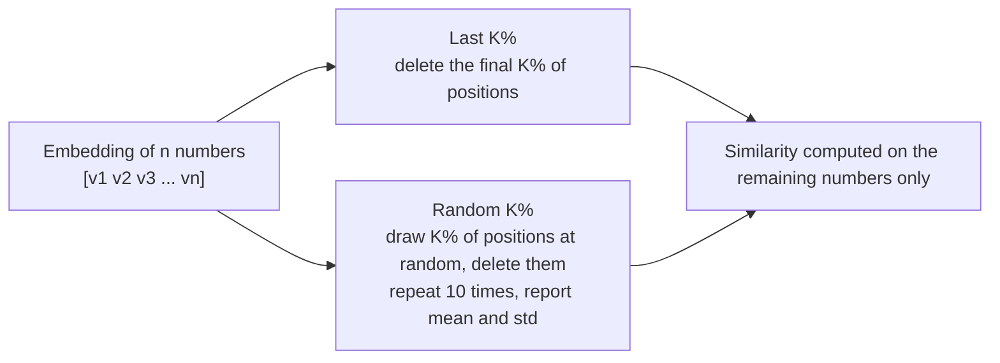

A 16-number example with half removed at random: `[v1 . v3 v4 . . v7 . v9 . . v12 v13 . v15 .]` (dots are deleted). Query and document lose the **same** positions, and similarity is computed on the 8 remaining numbers.

The paper removes dimensions instead of setting them to zero, arguing that zeroing "may have varying impact". For the dot product and the cosine this argument is empty: a zero contributes nothing to the dot product or to the length, exactly like a missing number, so both give identical scores. We verified this to 1e-13 (and the demo prints it).

## 2.5 Result 1: random truncation barely hurts

Retrieval and classification keep most of their quality even when half the dimensions are gone, and the curves for last-K and random-K look alike. Only at 80 to 90% removal does quality collapse (last-K stays above 80% up to 80% removal for five of six encoders; E5-Mistral keeps 90% of its quality even with 90% removed). Contriever is the most fragile model, especially on retrieval. The 10 random draws give small standard deviations, so the result does not depend on which dimensions are drawn; Appendix Fig 7 repeats the picture for three differently seeded training runs.

Paper Table 2 (relative performance at 50% random removal, %):

| Encoder | BEIR random | MTEB random |
|---|---|---|
| MPNet | 97.7 | 96.6 |
| Contriever | 87.3 | 95.4 |
| E5-large | 95.9 | 97.7 |
| E5-Mistral (NanoBEIR) | 99.6 | 98.2 |
| Paraphrase-MiniLM | 94.6 | 97.4 |
| Sentence-T5 | 95.9 | 97.8 |

Our reproduction of the curve (Fig 2c and 2d of the paper), per model, 10 seeds, with the paper's average as the dashed line:

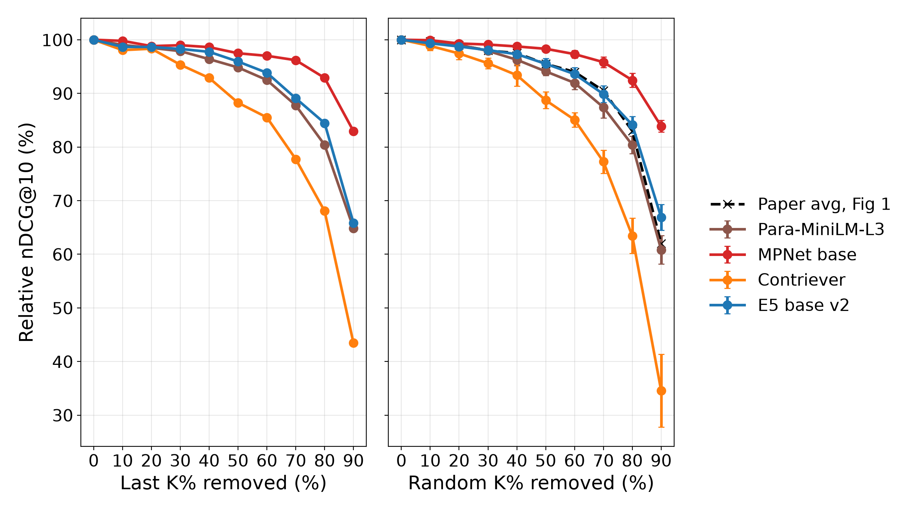

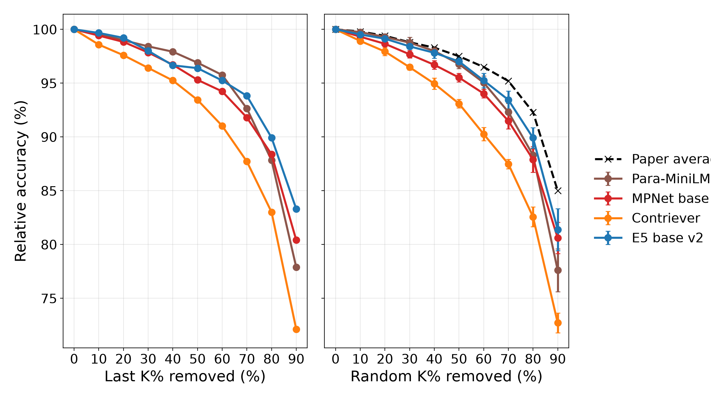

## 2.6 Do the rankings survive? (Spearman, Fig 8)

For each query the paper ranks all documents with the full embedding and with the truncated one and computes the Spearman correlation. At 50% last-K removal it stays above 0.8 for all models (E5-Mistral about 0.95, Sentence-T5 0.92, MPNet 0.90, E5-large 0.88, MiniLM 0.88, Contriever 0.85). At 90% it drops to 0.43 (Contriever) to 0.74 (E5-Mistral). So truncation preserves the geometry of the space well enough that retrieval and classification mostly do not notice.

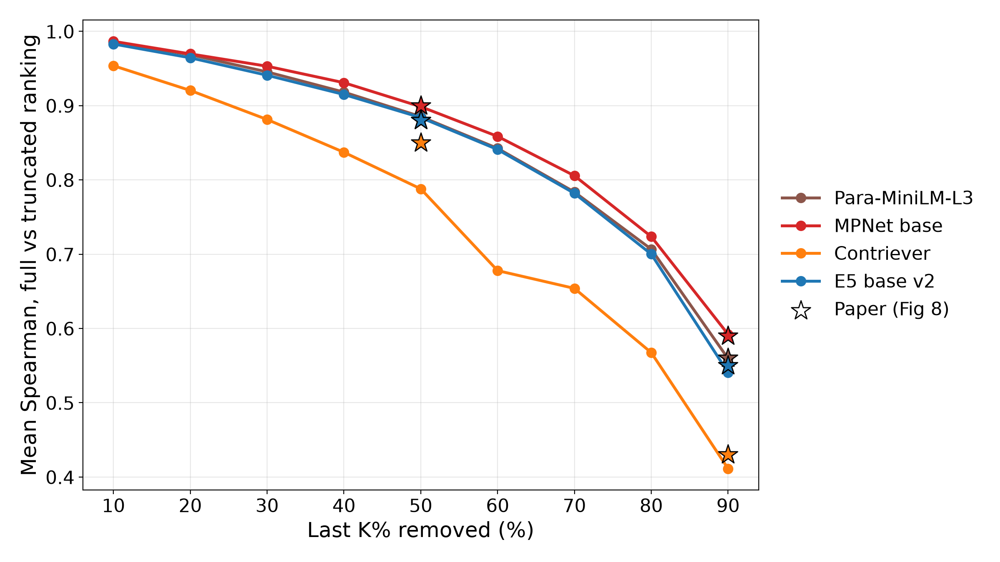

## 2.7 Why does it work? Three hypotheses that fail

The intuition: if the encoder uses its space efficiently, deleting dimensions should hurt a lot. So perhaps the encoder uses its space inefficiently. The paper tests three ways in which that could be true.

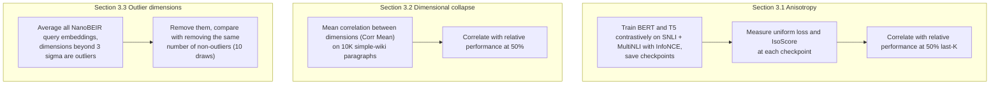

**Anisotropy (3.1).** Anisotropic embeddings sit in a narrow cone and use the space unevenly. As contrastive training proceeds, anisotropy falls and full-size performance rises, but the relative performance of half-size embeddings stays flat (T5 98 to 102%, BERT 94.5 to 98%). Pearson correlations with relative performance are weak: T5 uniform loss 0.36 and IsoScore -0.47; BERT uniform loss -0.35 and IsoScore 0.39.

**Dimensional collapse (3.2).** If many dimensions are correlated, deleting some should lose little. The paper measures the mean correlation between dimensions over training checkpoints and finds no clear relation (Pearson 0.45 for T5, -0.30 for BERT).

**Outlier dimensions (3.3).** Following Kovaleva et al., a few dimensions with huge values could dominate. The paper finds 1 to 5 such dimensions per model (32 for E5-Mistral) and shows removing them changes nDCG@10 no more than removing random dimensions, except for E5-Mistral:

| Model | # outliers | Without outliers | Without random non-outliers |
|---|---|---|---|
| MPNet | 5 | 0.576 | 0.576 ± 9e-4 |
| Contriever | 3 | 0.525 | 0.524 ± 1e-3 |
| E5-large | 1 | 0.577 | 0.577 ± 4e-4 |
| E5-Mistral | 32 | 0.651 | 0.626 ± 6e-4 |
| Paraphrase-MiniLM | 2 | 0.483 | 0.483 ± 6e-4 |
| Sentence-T5 | 2 | 0.489 | 0.489 ± 9e-4 |

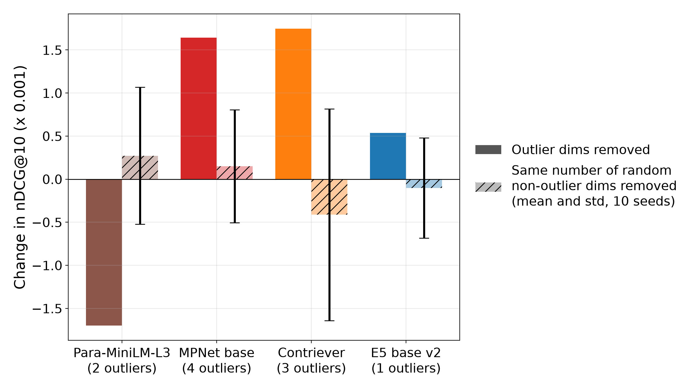

## 2.8 The paper's own explanation: degrading dimensions

**Attribution method (Section 4).** Remove one dimension at a time and re-evaluate. If the score goes **up** when dimension i is removed, dimension i is *degrading*; if it goes down, it is *improving*; if unchanged, a *tie*. This is done on 13 NanoBEIR datasets and 12 MTEB datasets for all 6 models.

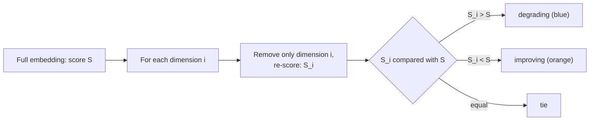

**Finding 1 (Fig 4).** In every model and benchmark an astonishing number of dimensions are degrading, in some cases more than half. Examples (degrading / improving / tie): MPNet on NanoBEIR 595 / 169 / 4; Contriever 498 / 270 / 0 (65% degrading on NanoBEIR, 52% on MTEB); E5-large on MTEB 430 / 594 / 0 of 1024; E5-Mistral on NanoBEIR 2652 / 1419 / 25; MiniLM 117 / 267 / 0. The individual effects are tiny, of order 1e-3 nDCG or less. The degrading dimensions look uniformly spread over the vector, not clustered.

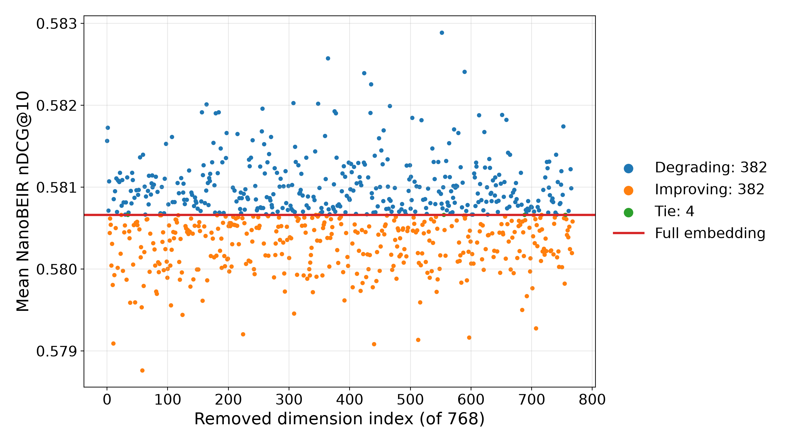

**Finding 2 (Fig 5, Fig 12).** Remove only the degrading dimensions, strongest first: performance rises above 100% for Sentence-T5 (about 103%), E5-large, E5-Mistral (about 102%) and Paraphrase-MiniLM, and decays more slowly than last-K for Contriever and MPNet. Remove only the improving dimensions and performance falls faster than last-K.

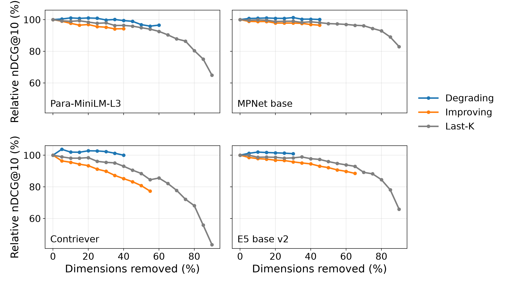

**The explanation.** A random cut removes about as many helpful as harmful dimensions; their effects roughly cancel, so the loss is small.

**Finding 3 (Fig 6): shared degrading dimensions.** Degrading dimensions are found separately for each of the 13 NanoBEIR datasets and counted across datasets. No dimension is degrading on all 13 datasets, but many are degrading on several: for MPNet more than 20% of the dimensions degrade on five datasets. This hints at domain-specific methods to find them.

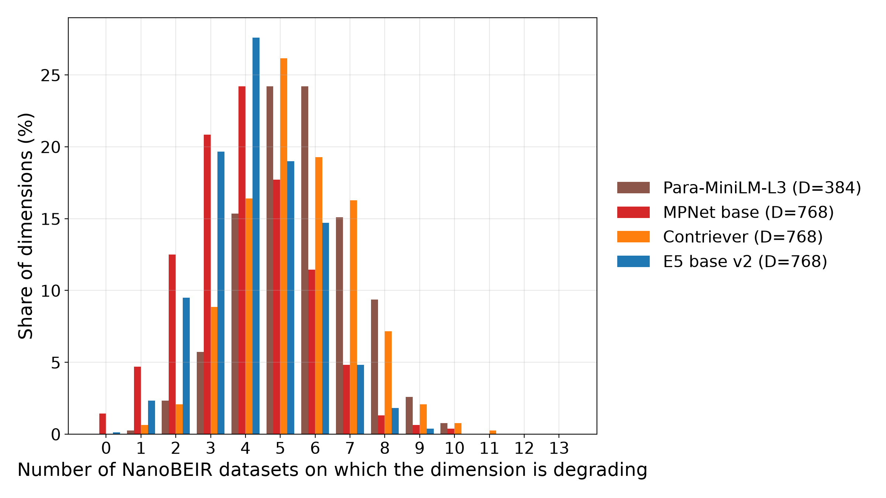

**Outlier degrading dimensions in E5-Mistral (Fig 13).** 19 degrading dimensions have a much larger effect than the rest (beyond 3 sigma), and 12 of them are also value outliers. This may explain why E5-Mistral keeps 90% of its quality at 90% removal.

## 2.9 Random truncation against PCA

PCA (scikit-learn, fitted on 20,000 sentences of all-nli) keeps the 50% directions with most variance. It needs fitting and extra computation; random truncation needs nothing. Table 2 (relative performance at 50%, %):

| Encoder | BEIR random | BEIR PCA | MTEB random | MTEB PCA |
|---|---|---|---|---|
| MPNet | 97.7 | 99.4 | 96.6 | 99.6 |
| Contriever | 87.3 | **77.3** | 95.4 | 98.5 |
| E5-large | 95.9 | **90.6** | 97.7 | 99.8 |
| E5-Mistral | 99.6 | 100.6 | 98.2 | 100.4 |
| Paraphrase-MiniLM | 94.6 | 99.3 | 97.4 | 99.5 |
| Sentence-T5 | 95.9 | 100.2 | 97.8 | 99.9 |

PCA is usually a little better, but random truncation is surprisingly close and even wins for Contriever and E5-large on BEIR.

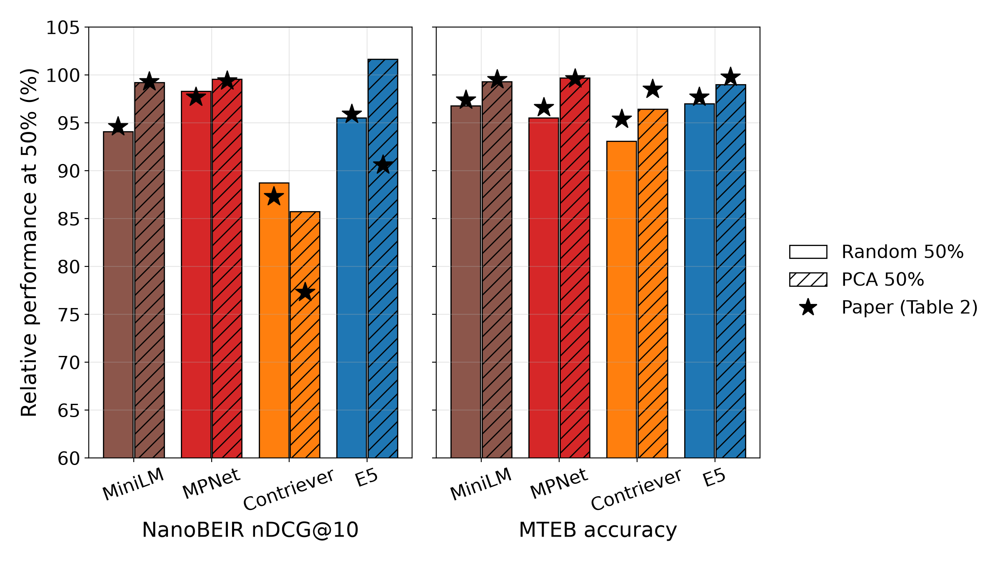

## 2.10 Large language models

The same idea applied to a causal LLM: remove the first or the last half of the final hidden state and the matching half of the unembedding matrix, then score with the Language Model Evaluation Harness. Table 3 (performance and, in brackets, relative performance):

| Model | Task | Full | First half removed | Last half removed |
|---|---|---|---|---|
| Llama 3.1 8B | MMLU acc | 0.681 | 0.580 (0.852) | 0.586 (0.861) |
| Llama 3.1 8B | SQuAD v2 best exact | 51.87 | 50.07 (0.965) | 50.07 (0.965) |
| Llama 3.1 8B | GSM8K strict EM | 0.764 | 0.009 (0.012) | 0.014 (0.018) |
| Qwen 2.5 7B | MMLU acc | 0.718 | 0.709 (0.988) | 0.709 (0.987) |
| Qwen 2.5 7B | SQuAD v2 best exact | 50.12 | 50.07 (0.999) | 50.07 (0.999) |
| Qwen 2.5 7B | GSM8K strict EM | 0.766 | 0.045 (0.059) | 0.011 (0.014) |

Multiple-choice and extraction tasks keep more than 80% of the quality, but math word problems (GSM8K) collapse, so the effect is task dependent for LLMs.

## 2.11 Limitations the authors state

- The cause of the degrading dimensions is unknown.
- Only single-dimension attribution is studied, not groups.
- English only.
- The relation to Matryoshka (MRL) models is untested (an informal check found MRL and non-MRL MPNet comparable).

## 2.12 What the paper does not address (our critique)

We found nine points; the three that matter most were tested with new experiments.

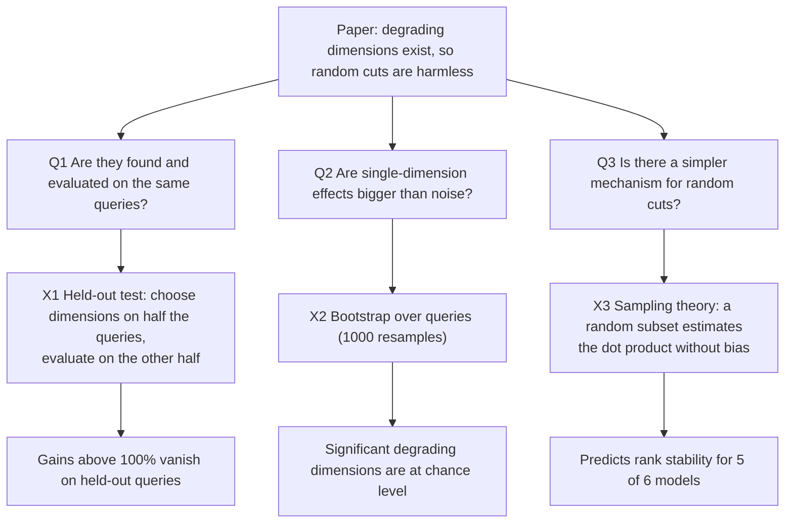

**X1. Selection leakage.** The paper identifies degrading dimensions and evaluates their removal on the same queries (Fig 5, 12), so gains above 100% may be selection on noise. We split queries 50/50 five times, select on half A and test on half B. Gains of up to 103% in sample become 97.9 to 100.2% held out, and the per-dimension effects on the two halves are uncorrelated (r between -0.05 and 0.01).

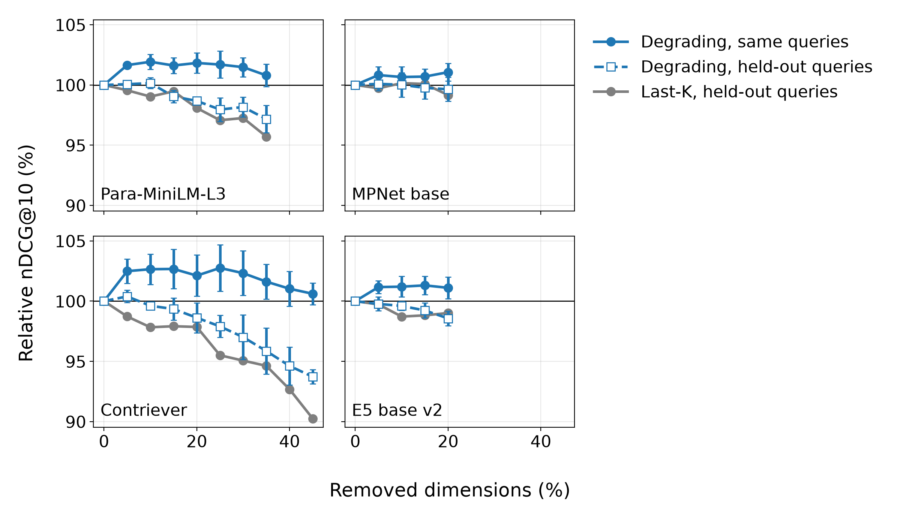

**X2. Significance.** Per-dimension effects are about 3 to 5e-4 nDCG@10, while the standard error of the benchmark score is 0.012 (23 to 43 times larger). Only 8 to 22 degrading dimensions per model have a 95% bootstrap interval excluding zero, about what chance gives (9.6 to 19.2).

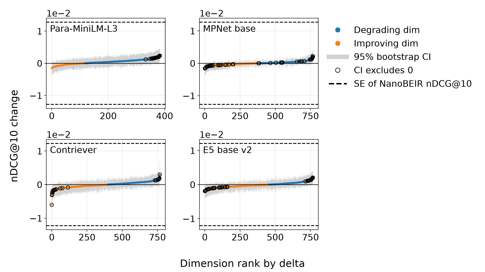

**X3. A mechanism the paper does not give.** A score q.d is a sum of n per-dimension products. A random subset of m dimensions gives an unbiased estimate of that sum (scaled by n/m) whose variance depends on how spread out the products are, with a finite-population correction (n - m)/(n - 1). Two documents swap order only when their score gap is smaller than that noise. Our formula predicts the observed rank correlation within 0.03 for 5 of 6 models; it fails for E5 because it ignores renormalisation. Contriever has the most concentrated contributions (participation ratio 0.04), consistent with it being the most fragile.

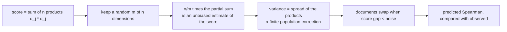

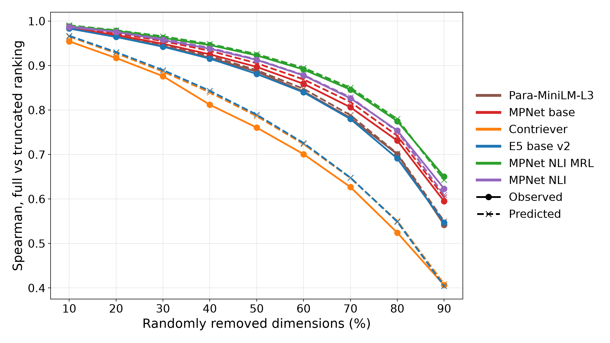

Other points: Table 4 repeats the Table 3 MMLU numbers in its HellaSwag column and COPA F1 equals DROP F1 in every row (likely copy errors); SQuAD v2 scores 50.07 for every truncated model, about the share of unanswerable questions, so the model probably always answers "no answer"; the anisotropy test varies checkpoints of only two small models; Contriever, the least robust model, is the only one using an unnormalised dot product, which the paper does not discuss; the claim that degrading dimensions are "uniformly distributed" is made visually, not tested.

## 2.13 How the live demo maps to the paper

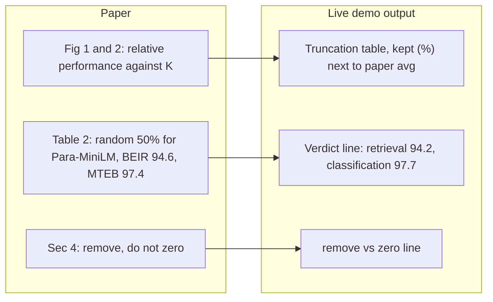

---

# Part 3. Our reproduction

Everything below documents what we built to test the paper: results against the paper's numbers, scope, method, repository layout and how to regenerate every result. Per-claim tables are in [RESULTS.md](RESULTS.md), all scope decisions and the audit in [REPRO_NOTES.md](REPRO_NOTES.md), the viva questions in [docs/VIVA.md](docs/VIVA.md).

### 3.1 What this repository reproduces

| Paper element | Experiment | Status |
|---|---|---|
| Fig 2: last-K and random-K truncation | E1 | Reproduced |
| Fig 8: Spearman between full and truncated rankings | E2 | Reproduced |
| Table 2: random 50% vs PCA 50% | E3 | Reproduced |
| Limitation (iv): MRL vs non-MRL models | E4 | New result |
| Justification for removing rather than zeroing | E5 | Tested: the two are identical |
| Table 1: outlier dimensions | E6 | Reproduced |
| Fig 4: leave-one-dimension-out attribution | E7 | Reproduced (retrieval; classification for 2 models x 2 tasks) |
| Fig 5, Fig 12: removing only degrading or improving dims | E8 | Reproduced in sample |
| Fig 6: degrading dims shared across datasets | E9 | Reproduced |
| Sec 3.1, 3.2: anisotropy and dimensional collapse | E10 | Cross model version (no retraining) |
| Table 3: LLM hidden state truncation | S1 | Reproduced on Qwen2.5-0.5B |
| Not in the paper | X1 selection leakage, X2 significance, X3 sampling theory | Extensions |

### 3.2 Headline results

| Claim | This reproduction | Paper |
|---|---|---|
| Random 50%, NanoBEIR nDCG@10 kept | 88.7 to 98.3% | 87.3 to 97.7% |
| Random 50%, MTEB accuracy kept | 93.1 to 97.0% | 95.4 to 97.7% |
| Full nDCG@10, MPNet / Contriever / MiniLM | 0.581 / 0.528 / 0.487 | 0.576 / 0.524 / 0.484 |
| Spearman at 50% last-K, MPNet / MiniLM | 0.899 / 0.885 | 0.90 / 0.88 |
| Outlier dims, MiniLM / MPNet / Contriever / E5 | 2 / 4 / 3 / 1 | 2 / 5 / 3 / 1 |
| PCA beats random 50% except Contriever retrieval | yes | yes |
| Removing degrading dims exceeds 100% | yes, in sample (up to 103.7%) | yes (up to about 103%) |

Main findings:

1. **The core claim reproduces.** Random removal of half the dimensions keeps most of the performance, with Contriever as the fragile outlier, as in the paper.
2. **The paper's explanation does not survive a held out test (X1, X2).** Degrading dimensions chosen on one half of the queries give no gain on the other half (best held out result 100.3%), and their per dimension effects on two disjoint query halves are uncorrelated (r between -0.05 and 0.01). The number of degrading dimensions with a bootstrap confidence interval excluding zero is at the level expected by chance, and the median effect of one dimension (3 to 5e-4 nDCG@10) is 23 to 43 times smaller than the standard error of the benchmark score (0.012).
3. **A simpler mechanism explains the robustness (X3).** A score q.d is a sum of per dimension products, and a random subset of dimensions gives an unbiased, scaled estimate of that sum. Rankings survive whenever contributions are spread over many dimensions. This model predicts the observed rank correlation at 50% within 0.03 for 5 of 6 models, and identifies Contriever as the model with the most concentrated contributions.

Every claim, with the reproduced number, the paper's number and a note on agreement, is in [RESULTS.md](RESULTS.md).

### 3.3 Scope

| Paper | This reproduction |
|---|---|
| 6 encoders | 4 core encoders (Paraphrase-MiniLM-L3, all-mpnet-base-v2, Contriever, E5-base-v2) plus an MRL / non-MRL MPNet pair |
| 14 BEIR datasets | All 13 NanoBEIR datasets |
| 12 MTEB classification tasks | Banking77, Emotion, TweetSentimentExtraction, MTOPIntent (en) |
| Contrastive retraining of BERT and T5 for anisotropy | Cross model comparison of the same metrics on 6 models |
| Llama 3.1 8B, Qwen 2.5 7B | Qwen2.5-0.5B |

Every reduction is justified, and every protocol choice and deviation is recorded, in [REPRO_NOTES.md](REPRO_NOTES.md).

### 3.4 Method and implementation

All truncation, metric, attribution and evaluation code is implemented independently in numpy and torch. Pretrained encoders and Hugging Face datasets are used only as inputs. The authors' code was not used.

**Encoding.** Each corpus is encoded once per model with sentence-transformers (fp16 on GPU) and cached as float32 `.npy` files with a metadata file recording model, dataset, prefix and normalisation. E5 uses its `query: ` and `passage: ` prefixes. All later experiments only slice these arrays.

**Truncation** (`src/truncate.py`). Last-K keeps the first D minus round(K x D) dimensions. Random-K draws round(K x D) dimensions to remove with a seeded generator, over 10 seeds (0 to 9) as in the paper. PCA is an SVD on 20,000 all-nli sentences, keeping D/2 components.

**Similarity.** Cosine for all models except Contriever, which uses the raw dot product. Cosine models are renormalised after truncation by the cosine itself.

**Metrics** (`src/metrics.py`). nDCG@10 with linear gain, as in pytrec_eval and BEIR, excluding a document whose id equals the query id, as BEIR and MTEB do. It matches pytrec_eval to 4e-8 per query. Classification follows the MTEB protocol: 10 experiments, each fitting a logistic regression (max_iter 100) on a class balanced subsample of the training set (8, 16 or 32 examples per label depending on the task), scored by accuracy on the test set. The same 10 subsamples are reused for every truncation setting.

**Attribution** (`src/attribution.py`). Leave-one-dimension-out is computed in closed form for all dimensions at once instead of rescoring the corpus D times. For cosine,

    score_without_i = (q.d - q_i d_i) / ( sqrt(|q|^2 - q_i^2) * sqrt(|d|^2 - d_i^2) )

and for the dot product the term q_i d_i is simply subtracted. A dimension is degrading if removing it raises the NanoBEIR mean nDCG@10.

**Sampling theory** (`src/theory.py`). For a document pair (a, b) and query q, let r_j = q_j (a_j - b_j). Keeping a random m of n dimensions estimates the score difference sum_j r_j with variance n^2 sigma_r^2 / m x (n - m) / (n - 1) (sampling without replacement). The probability that the pair swaps order follows from a normal approximation; averaging over pairs gives a predicted Kendall tau, converted to Spearman through the Gaussian relation.

### 3.5 Repository layout

```
docs/                     paper, assignment brief, reference numbers (PAPER_NOTES.md)
src/
  data.py                 NanoBEIR, MTEB classification and sentence set loaders
  encode.py               model registry, prefixes, encoding and caching
  metrics.py              nDCG@10, Spearman, MTEB logistic regression protocol
  truncate.py             last-K, random-K, index removal, PCA
  evaluate.py             retrieval and classification evaluators over cached or live arrays
  live.py                 subset, sweep, remove-vs-zero, classification plan, replay; shared by the live run
  runtime.py              thread count, CPU forcing, UTF-8 console
  attribution.py          leave-one-dimension-out, outliers, anisotropy metrics
  theory.py               subsampling variance and rank swap model
  paper.py                every reference number taken from the paper
  plotting.py             shared figure style and model colours
scripts/
  fetch_cache.py          download the precomputed embeddings from the release
  fetch_lite.py           save the MiniLM weights and the live-run data into lite/, build the zip
  live_small.py           live run: encode, truncate, compare with the paper, replay fallback
  check_setup.py          ok / FAIL check of Python, packages, files and a smoke run
  self_check.py           runs the checks and live runs and writes a report to send back
  encode_all.py           encode every model and dataset into cache/
  e0_full_scores.py       full dimension scores and pytrec_eval check
  e1 ... e10              paper experiments (section 3)
  x1, x2, x3              extensions (section 3)
  s1_llm_truncation.py    Qwen2.5-0.5B hidden state truncation
  demo_cli.py             command line fallback for the demo
demo/app.py, demo/core.py Streamlit demo
results/                  machine readable output of every experiment (csv, json)
figures/                  every figure as 200 dpi png (2400 x 1350) and pdf
run_all.sh                regenerates all results and figures
run.bat, run.sh           one-step launchers for the live run (venv, install, run)
requirements-demo.txt     CPU-only version ranges for the live run and the demo (Python 3.10 to 3.13)
tests/                    pytest: metrics, truncation, remove vs zero, subset, fallback
lite/                     MiniLM weights and live-run data (weights are not in git)
docs/RUN_SHEET.md         commands, expected output, what to say, fallbacks
docs/VIVA.md              likely viva questions with answers
docs/SELF_CHECK.md        5-minute check for a teammate's laptop
RESULTS.md                reproduced numbers vs the paper, claim by claim
REPRO_NOTES.md            scope reductions, protocol, deviations, runtimes, weaknesses
```

### 3.6 Reproducing all results

Every result and figure is regenerated from the cache with one script (about 1.5 hours on CPU). On Windows it runs in Git Bash. If `cache/emb/READY` is missing, it first encodes every dataset (about 50 minutes on a laptop RTX 4060, several hours on CPU).

```bash
bash run_all.sh
```

The Qwen2.5-0.5B experiment needs a GPU and downloads the model and benchmark items, so it runs only when requested:

```bash
RUN_S1=1 bash run_all.sh
```

### 3.7 Outputs

Each figure is generated from the csv listed next to it, which contains the plotted values.

| Figure | Data |
|---|---|
| fig_trunc_retrieval | results/fig_trunc_retrieval.csv |
| fig_trunc_classification | results/fig_trunc_classification.csv |
| fig_spearman | results/fig_spearman.csv |
| fig_pca_vs_random | results/fig_pca_vs_random.csv |
| fig_mrl | results/fig_mrl.csv |
| fig_outliers | results/e6_outliers.csv |
| fig_attribution_{model} | results/e7_attribution_retrieval.csv |
| fig_degrading_removal | results/e8_degrading_removal.csv |
| fig_shared_degrading | results/e9_shared_degrading.csv |
| fig_anisotropy_vs_drop | results/e10_anisotropy.csv, results/e10_correlations.csv |
| fig_leakage | results/x1_leakage_plot.csv |
| fig_bootstrap | results/x2_bootstrap_dims.csv, results/x2_bootstrap.csv |
| fig_theory_vs_observed | results/x3_theory_vs_observed.csv |
| fig_concentration_vs_drop | results/x3_concentration.csv, results/x3_correlations.csv |

Live run: `live_small_<model>_<dataset>.csv` and `live_small_cls_<model>_<task>.csv` (the `_fast` variants come from `--fast`). Other results: `e0_*` (full scores, encoding times, metric check), `e1_*` (all truncation runs per dataset and seed), `e2_*` (Spearman per dataset), `e3_pca.csv`, `e4_mrl.csv`, `e5_remove_vs_zero.json`, `e7_attribution_classification.csv`, `x1_*`, `x2_*`, `x3_*`, `s1_*` (LLM results and generated GSM8K answers).

### 3.8 Key design decisions

- **NanoBEIR instead of full BEIR.** The paper itself uses NanoBEIR for its largest model and for all attribution analyses, and its 13 datasets cover every BEIR domain at 50 queries each.
- **Closed form attribution.** Removing a dimension changes q.d by exactly q_i d_i, so all D leave-one-out scores follow from one score matrix; this makes E7, X1 and X2 take minutes instead of hours.
- **Removal equals zeroing.** For cosine and dot similarity, a removed coordinate and a zeroed coordinate contribute nothing to the dot product or the norms, so the two give identical scores (E5 confirms this to 1e-13). The paper's stated reason for preferring removal therefore does not apply.
- **Dot product for Contriever.** Checked against the paper: dot product reproduces its full score, random 50% and PCA numbers, while cosine does not (RESULTS.md, C3).
- **One device for all reported numbers.** CPU and GPU arithmetic differ by up to 2e-4 nDCG@10, the same size as single dimension effects, so every reported number comes from one CPU run.
- **Held out evaluation (X1).** Selecting dimensions and evaluating on the same queries cannot separate a real effect from selection on noise; splitting queries can.

### 3.9 Limitations

- Four of the twelve MTEB classification tasks are used, and NanoBEIR (50 queries per dataset) replaces full BEIR.
- E5-base-v2 stands in for E5-large; E5-Mistral (7B) and Sentence-T5 are not included.
- The LLM experiment uses Qwen2.5-0.5B instead of Qwen2.5-7B and Llama 3.1 8B.
- The anisotropy analysis compares 6 trained models instead of retraining BERT and T5 and tracking checkpoints.
- Cross model correlations rest on only 6 models.

The 7B to 8B models and the retraining experiment need more GPU memory than the 8 GB laptop GPU used here. The course HPC was considered for them, but on the run date the course account was limited to a shared half of one GPU (Slurm QOS `gres/gpu=0`, `mps=50`, 4 CPUs, 80 GB RAM), all five GPUs of the only partition open to it were allocated to multi day jobs, and 22 jobs were queued ahead. These experiments are therefore left as future work. Details and further weaknesses are listed in [REPRO_NOTES.md](REPRO_NOTES.md).

### 3.10 Hardware

Developed and run on a laptop: NVIDIA GeForce RTX 4060 Laptop GPU (8 GB), 16 logical CPU cores, 16 GB RAM, Windows 11, Python 3.13. Per step runtimes are in REPRO_NOTES.md.
